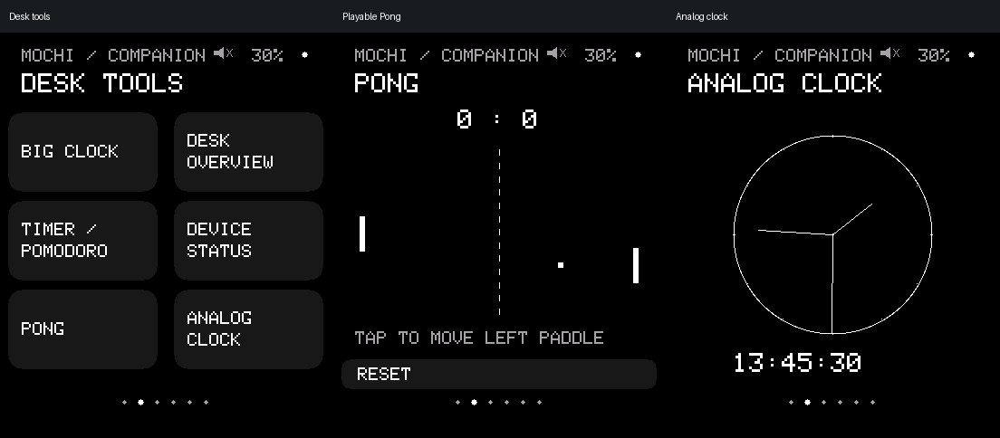
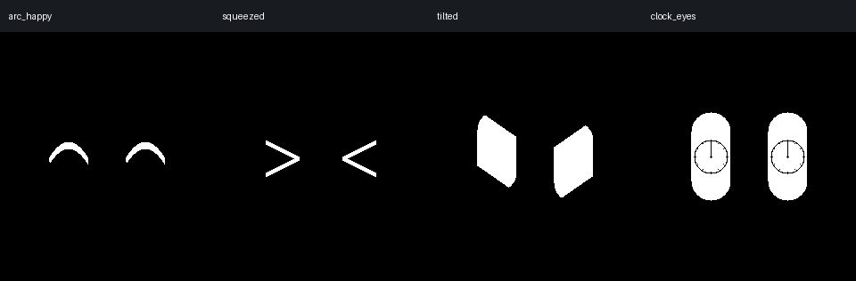
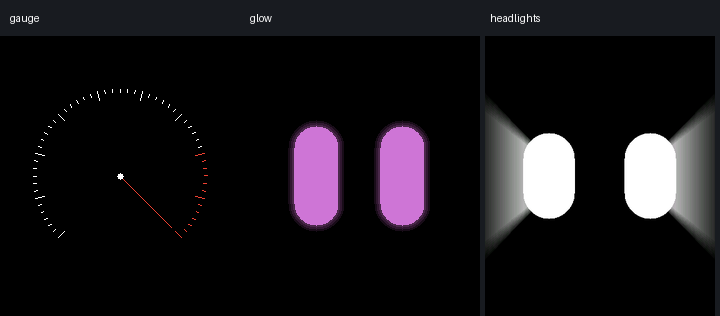
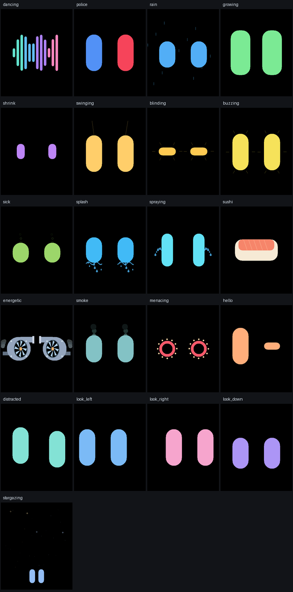

# OTA-Bot-Mochi

OTA-Bot-Mochi is a desk robot companion that blinks, reacts to touch and tilt, and displays information
received from a phone.

The firmware targets the Waveshare **ESP32-S3-Touch-LCD-1.69 OLD** and, through a separate build profile, the
**ESP32-S3-Touch-AMOLED-1.8 V2**. It is an Arduino C++ project, not a general-purpose ESP32 display firmware.

[](LICENSE)
[](https://github.com/camiu01/OTA-Bot-Mochi/actions/workflows/checks.yml)

[Hardware](#hardware) · [Build and flash](#build-and-flash) · [Controls](#controls-and-everyday-use) · [Configuration](#configuration) · [Known limits](#limitations-and-troubleshooting)

## Start here

- **Without a phone:** animated eyes, touch/motion reactions, Pong and local timers.
- **With Chronos:** time synchronization, notifications/calls, weather and navigation.
  Clocks keep time while disconnected, but need synchronization after reboot.
- **Board:** use exactly LCD **1.69 OLD** (PSRAM disabled) or AMOLED **1.8 V2**
  (OPI PSRAM). Other revisions are not interchangeable.
- **Install:** download a [release](https://github.com/camiu01/OTA-Bot-Mochi/releases)
  and follow [first installation versus update](docs/INSTALLING.md).
  Source builds are described below.
- **Evidence:** the user reports “everything works”; this is general functional
  confirmation, not a two-board or endurance certificate. See
  [validation records](docs/HARDWARE_VALIDATION.md) and [release evidence](docs/CI.md).
- **Limits:** no wireless firmware updater, verified battery runtime, or AMOLED
  charging/battery driver. “OTA” in the name does not imply OTA updates.

## See it in action



These are existing **native emulator screenshots**, not photos of a running board. The clock and phone data
are synthetic. No device photo or video demo is included in the repository; the images show source behavior,
not hardware validation.



Left to right: `arc_happy`, `squeezed`, `tilted`, and `clock_eyes`.



The gauge is an animation, not a speed/RPM instrument. Glow returns to the selected eye color; headlight beams grow outward
from the eyes. These still images do not show the transitions.

## What it does

"Available" below means implemented in the current source. It does not mean every feature has passed physical
testing on both boards. See the validation limits below.

### Available in the source

| Feature | Observable behavior |
| --- | --- |
| Animated eyes | Four styles (`mochi`, `bloub`, `normal`, `trapez`), with blinking, idle gaze, and 134 selectable moods |
| Touch reactions | Taps, double taps, and vertical petting strokes trigger temporary faces, then restore the selected mood |
| Motion reactions | Accelerometer changes relative to saved calibration (or a temporary startup reference) move the gaze; optional motion moods and shake-to-dizzy reactions |
| Digital and analog clocks | Display phone-synchronized time; continue while disconnected, but require another sync after reboot |
| Desk tools | Large clock, time/weather overview, device status, playable Pong, and local timers |
| Timer / Pomodoro | 5-minute or 15-minute timer, or one 25-minute work / 5-minute rest pair; keeps running when viewing another page |
| Phone navigation | Displays received turn instructions, icon, distance, ETA, and speed when supplied |
| Alerts and calls | Keeps eight local alerts with browsing, dismissal and message pagination; displays incoming caller information; calls must be handled on the phone |
| Weather display | Shows phone-supplied conditions and up to three forecast entries, with missing/stale states |
| Optional sound | Short generated chirps for reactions, timers, and alerts; category switches and night mute; off by default |
| Personalization | Eye colors, brightness, 180-degree screen flip, motion presets, EN/IT labels, and explicitly saved preferences |
| Power button | AMOLED V2: PWR 4s off / 1s on. LCD OLD: hold PWR 4s and release to turn off, press to restart; USB uses light sleep. Hardware switching requires board validation |

Eyes and local desk Pong/timers work without a phone. Clocks need an initial Chronos time sync after each
boot. Weather, notifications, calls, and navigation depend on the phone and the **Chronos companion app**.
Navigation instructions come from the phone through Chronos, not from an onboard GPS or route planner. The
firmware does not fetch weather directly.

The animated moods are distinct from desk tools: `pong` and `gauge` morph from eyes into a scene and
back; `clock_eyes` is a decorative animation, not the actual clock; `glow` cycles selected color → hues → selected color;
`headlights` expands beams over 1.2 seconds before softly pulsing. See the
[eye engine reference](OTA-bot-Mochi/src/eyes/README.md) for all mood names.

Twenty-six [original colored performances](docs/ANIMATIONS.md) add an equalizer,
rain, red/blue lights, growing/shrinking eyes, car turbochargers, a single sushi,
deliberate glances and a starry sky. They use reversible six-second loops, not bundled GIFs.



These stills show the performance phase, not the transitions or physical hardware.
A [240x280 gallery](docs/images/colored-performances-240.png) shows the LCD layout.

### Experimental and incompletely validated

- AMOLED V2 bring-up and later user functional confirmation are recorded in
  [Boards](docs/BOARDS.md). The latest general confirmation supersedes the
  reported weather/audio failures, but does not enumerate settings or duration.
- Repeatable per-board checks of orientation, brightness, audio categories,
  navigation, calibration restoration and reconnection remain useful release
  acceptance work, not additional known failures. LCD OLD needs separate checks.
- LCD battery percentage is an uncalibrated, plausibility-gated estimate.
  AMOLED battery data and charging state are not implemented.

### Planned or deferred

Battery/charging support, power/runtime measurements, and automatic OTA deployment remain open in [TODO](TODO.md).
No enclosure design or fabrication files are supplied.

**About "OTA":** the BLE name is `OTA bot`; the repository does not explain the acronym's origin.
No firmware OTA updater is implemented. Artifact/release packaging is not wireless deployment.

## Hardware

Choose **one** supported board. These profiles do not establish compatibility with the newer 1.69 revision,
AMOLED V1 (SH8601), or other ESP32 display boards.

| Component | Verified model or specification in the repository | Required / optional | Function |
| --- | --- | --- | --- |
| LCD board option | Waveshare ESP32-S3-Touch-LCD-1.69 **OLD**, ESP32-S3, 16 MB flash | Required alternative; assembled board | Default firmware target |
| LCD display / touch | Integrated ST7789, 240x280 SPI; touch probes CST816/FT6X36 families | Included with LCD board | Display and touch input; probe address does not identify the exact touch chip |
| AMOLED board option | Waveshare ESP32-S3-Touch-AMOLED-1.8 **V2**, ESP32-S3, 16 MB flash, 8 MB octal PSRAM | Required alternative; assembled board | Second, partially validated target |
| AMOLED display / touch | Integrated CO5300, 368x448 QSPI; CST820 in the V2 profile | Included with AMOLED board | Display and touch input |
| Motion sensor | Board-integrated QMI8658C; firmware enables its accelerometer only | Included; motion is optional for basic operation | Relative tilt/acceleration reactions; idle eyes remain usable if initialization fails |
| Audio path | LCD GPIO33 buzzer; AMOLED ES8311 codec/I2S and amplifier enable | Board-specific hardware; sound optional | Generated short cues, not speech, music playback, or microphone capture |
| Board RTC | RTC bus pins are recorded; no external-RTC driver is used by this firmware | Not required as a time source | Current clock comes from Chronos, not the board RTC |
| USB connection | Data-capable cable matching the board and a regulated USB source | Required separately for installation and the documented powered setup | Power, upload, diagnostics, and settings console |
| Phone with Chronos | BLE companion app | Optional separately; required for phone features | Time sync, route data, alerts, and weather |
| Battery / enclosure | No validated battery wiring specification or enclosure files supplied | Not required for USB-powered use | Battery integration and mechanical design remain outside this setup |

No external buttons are required. Everyday UI controls use touch and USB;
the integrated PWR button has board-specific shutdown/wake behavior described in
[Boards](docs/BOARDS.md). BOOT and RESET are not additional menu controls.

Power documentation specifies a regulated USB source, but does not establish current budget, battery connector
polarity, charging limits, or measured runtime. Do not infer a battery connection from the GPIO names. Never
connect a vehicle's 12 V supply directly. See [Boards](docs/BOARDS.md) and [Settings](docs/SETTINGS.md).

## Wiring and board configuration

Display, touch, IMU, and board-specific control signals are already routed on the supported boards. No
external signal wiring is required for the documented USB-powered setup. The following are **internal profile
assignments**, not a breadboard wiring guide; [pin_config.h](OTA-bot-Mochi/pin_config.h) is authoritative.

| Signal | LCD 1.69 OLD | AMOLED 1.8 V2 |
| --- | --- | --- |
| Display bus | SPI: DC4, CS5, SCK6, MOSI7, RST8 | QSPI: CS12, SCLK11, SDIO0..3 = GPIO4..7 |
| Shared I2C | SDA11 / SCL10 | SDA15 / SCL14 |
| Touch | RST13, INT14; probes `0x15` / `0x38` | No reset GPIO, INT21; V2 touch at `0x15` |
| Brightness | PWM backlight GPIO15 | CO5300 controller command; no backlight GPIO |
| Audio | Buzzer GPIO33 | ES8311 `0x18`; MCLK16, BCLK9, WS45, DOUT8, amplifier enable46 |
| Panel reset | GPIO8 | TCA9554 `0x20`, expander bits 0..2 |
| Battery candidate | `BAT_ADC=1`, divider unverified | `BAT_ADC=-1`; AXP2101 battery driver absent |

Touch and IMU use one shared I2C controller. Do not start a second controller on the same pads. On AMOLED, the
sketch releases the expander-controlled panel reset before display initialization.

**PSRAM settings are not interchangeable:**
- **LCD 1.69 OLD: disabled.** OPI PSRAM claims GPIO33/35/36, conflicting with the
  board's buzzer/power lines. A prior build caused continuous beeping and I2C crashes.
- **AMOLED V2: OPI enabled.** Its 368x448 RGB565 canvas needs about 330 KB and uses
  PSRAM. The panel controller and reset path also differ from AMOLED V1.

No local schematic or electrical pinout drawing is included; [Boards](docs/BOARDS.md) links manufacturer references.
Do not improvise battery, speaker, or power connections from this table.

## Build and flash

The firmware is an Arduino C++ sketch, and two build-tool paths are configured for it. Choose **one** path,
and use the profile matching the physical board; you do not need both workflows.

- **Arduino CLI** is the CI/reference path: CI compiles both board profiles with it, and the versions below are the
  CI pins. Arduino IDE 2.x is also documented, but the CLI makes the board profile and dependency versions
  explicit.
- **PlatformIO** is the main local verification path for this consolidation, configured in [platformio.ini](platformio.ini) with two
  environments that mirror the same board profiles.

There is no standalone ESP-IDF project: the ESP32 Arduino core embeds ESP-IDF underneath, but this repository
builds Arduino sketches only. The two paths pin slightly different toolchains (CI pins ESP32 core 3.3.11;
PlatformIO resolves Arduino core 3.3.12 through `espressif32 @ 8.0.0`), so a successful build on one path does
not verify the other.

### Arduino CLI (CI/reference path)

#### 1. Prerequisites

Install **Arduino CLI 1.2.0** and put `arduino-cli` in PATH. The IDE-bundled CLI is another supported route;
see [toolchain setup](docs/TESTING.md#arduino-cli). You also need Git and the board's USB data connection.

| Dependency | Version |
| --- | --- |
| ESP32 Arduino core | 3.3.11 |
| ChronosESP32 | 1.9.1 |
| GFX Library for Arduino | 1.6.9 |
| ESP32Time | 2.0.6 |
| NimBLE-Arduino | 2.5.1 |

#### 2. Clone

```sh
git clone https://github.com/camiu01/OTA-Bot-Mochi.git
cd OTA-Bot-Mochi
```

Run these single-line commands from the repository root, individually, in PowerShell or a POSIX shell.

#### 3. Install the core and libraries

```sh
arduino-cli core update-index --additional-urls https://espressif.github.io/arduino-esp32/package_esp32_index.json
arduino-cli core install esp32:esp32@3.3.11 --additional-urls https://espressif.github.io/arduino-esp32/package_esp32_index.json
arduino-cli lib install "ESP32Time@2.0.6" "NimBLE-Arduino@2.5.1"
arduino-cli lib install --no-deps "ChronosESP32@1.9.1" "GFX Library for Arduino@1.6.9"
```

#### 4. Select a target and compile

Compile **only the profile matching your board**. Separate build directories keep its binaries apart.

**LCD 1.69 OLD:**

```sh
arduino-cli compile --fqbn "esp32:esp32:esp32s3:CDCOnBoot=cdc,PSRAM=disabled,FlashSize=16M" --build-property "compiler.cpp.extra_flags=-DMOCHI_BOARD_LCD_169" --build-path build/lcd OTA-bot-Mochi
```

**AMOLED 1.8 V2:**

```sh
arduino-cli compile --fqbn "esp32:esp32:esp32s3:CDCOnBoot=cdc,PSRAM=opi,FlashSize=16M" --build-property "compiler.cpp.extra_flags=-DMOCHI_BOARD_AMOLED_18" --build-path build/amoled OTA-bot-Mochi
```

The sketch is [OTA-bot-Mochi.ino](OTA-bot-Mochi/OTA-bot-Mochi.ino); Arduino compiles its `src/` modules
recursively. Selecting "ESP32S3 Dev Module" alone does not select the AMOLED profile.

#### 5. Find the port and flash

```sh
arduino-cli board list
```

Close serial monitors. Replace `COM3` with your detected port, such as `/dev/ttyACM0` on Linux.
Upload **only after a successful compile**, using the same target and build directory.

**LCD 1.69 OLD:**

```sh
arduino-cli upload --port COM3 --fqbn "esp32:esp32:esp32s3:CDCOnBoot=cdc,PSRAM=disabled,FlashSize=16M" --build-path build/lcd OTA-bot-Mochi
```

**AMOLED 1.8 V2:**

```sh
arduino-cli upload --port COM3 --fqbn "esp32:esp32:esp32s3:CDCOnBoot=cdc,PSRAM=opi,FlashSize=16M" --build-path build/amoled OTA-bot-Mochi
```

Upload replaces the installed application. Do not erase flash or change partitions; saved settings may be lost.
Precompiled v1.2.0 binaries are available. Use [installation instructions](docs/INSTALLING.md)
for release images and [CI evidence](docs/CI.md) for their source revision and build results.

#### 6. First boot

Keep the board still in its intended desk position. The IMU restores saved calibration,
or uses a temporary reference until SENSORS → IMU zero succeeds. Open the serial
console if needed:

```sh
arduino-cli monitor --port COM3 --config baudrate=115200
```

Look for `UI ready`, the detected touch address, and `IMU ready` or `IMU unavailable; using idle eyes`. The
startup shows an animated OTA BOT / MOCHI title for 2.2 seconds, then a silent eye greeting. Defaults
are white MOCHI eyes, neutral mood, 30% day brightness, and sound off.

These Arduino CLI commands were not executed locally during this consolidation.
The inspected v1.2.0 CI run built both profiles at core **3.3.11**; earlier
AMOLED device bring-up used **3.3.12**. Neither build result identifies which
binary is currently installed or proves hardware operation.

### PlatformIO (alternative path)

`platformio.ini` at the repository root mirrors both board profiles with the same library pins, 16 MB flash,
and a 115200-baud serial monitor. Its default environment is `esp32s3-lcd`, so a bare `pio run` builds only
the LCD profile; always pass `-e` explicitly. Board revisions and pin assignments are in
[Boards](docs/BOARDS.md).

| Environment | Target board | Relevant configuration | Verification status |
| --- | --- | --- | --- |
| `esp32s3-lcd` (default) | Waveshare ESP32-S3-Touch-LCD-1.69 **OLD**, ST7789 240x280 | `-DMOCHI_BOARD_LCD_169=1`, USB CDC on boot, 16 MB flash, PSRAM off (never enable OPI on this revision) | Local build recorded 2026-10-20 with PlatformIO 6.2.0 in [Testing](docs/TESTING.md#platformio-alternative); not built by CI |
| `esp32s3-amoled` | Waveshare ESP32-S3-Touch-AMOLED-1.8 **V2**, CO5300 368x448 | `-DMOCHI_BOARD_AMOLED_18=1`, USB CDC on boot, 16 MB flash, `qio_opi` memory type (OPI PSRAM required) | Local build recorded 2026-10-20; one bench upload recorded 2026-10-21 in [Sound](docs/SOUND.md); hardware remains only partially validated; not built by CI |

The configuration uses `espressif32 @ 8.0.0` with the Arduino framework, which resolves Arduino core 3.3.12.
CI does not build these environments, and a compiling environment is not hardware validation; the PSRAM
settings above are not interchangeable.

1. Install [PlatformIO Core](https://docs.platformio.org/en/latest/core/installation.html) so `pio` is in
   `PATH`. Git and the board's USB data connection are needed as in the Arduino CLI prerequisites above.
2. From the repository root, build the environment matching your board:

	```sh
	pio run -e esp32s3-lcd
	pio run -e esp32s3-amoled
	```

3. Close other serial monitors, then find the upload port:

	```sh
	pio device list
	```

4. Upload **only** the environment matching the physical board. Replace `COM3` with the detected port, such
   as `/dev/ttyACM0` on Linux:

	```sh
	pio run -e esp32s3-lcd --target upload --upload-port COM3
	pio run -e esp32s3-amoled --target upload --upload-port COM3
	```

5. Open the serial monitor and check the same first-boot diagnostics as step 6 above (`UI ready`, the
   detected touch address, and `IMU ready` or `IMU unavailable; using idle eyes`):

	```sh
	pio device monitor --port COM3 --baud 115200
	```

Uploading replaces the installed application, exactly as with the Arduino CLI path; do not erase flash or
change partitions. Never flash the AMOLED image to the LCD board or the reverse: the two profiles require
different PSRAM configurations (see [Wiring and board configuration](#wiring-and-board-configuration)).

## Controls and everyday use

The primary carousel is: `Eyes → Clock → Route → Alerts → Weather → Settings → Eyes`. Desk tools are children
of Clock, not additional carousel pages.

| Action | Result |
| --- | --- |
| Swipe left / right | Next / previous main page |
| Tap / quick double tap on Eyes | Temporary random / playful face and a glance toward the touch |
| Stroke vertically on Eyes | Temporary affectionate face and a short-lived heart near the finger |
| Hold still on Eyes for 1.2 seconds | Open Settings |
| Swipe down on Clock | Open the six-tool desk menu |
| Swipe up from a tool / desk menu | Return to the desk menu / Clock |
| Tap the court in desk Pong | Move the left paddle to that height; RESET starts a new game |
| Swipe down on Route | Toggle large/details layout; holding Route restores the configured default |
| Swipe down on Weather | Queue a phone synchronization request, not a direct forecast fetch |
| Tap the top status strip on a utility page | Toggle sound for the session; inactive on Eyes and Settings |
| Tap SAVE in Settings | Persist the active preferences |

Settings uses vertical scrolling; swipes do not also edit a row. Timers have START/PAUSE, RESET, and MODE
controls, continue off-page, and reset after reboot. Pong pauses when its desk page is not visible.

To use phone features, open **Chronos**, connect to **`OTA bot`**, and allow the permissions needed by the
features you enable. Sync time in the app. The clock shows a waiting state until synchronization and follows
Chronos 12/24-hour mode; there is no on-device manual clock-setting command or external-RTC fallback.

Start navigation on the phone for route data. New notifications select Alerts; a new navigation session
selects Route. Routine route updates preserve a later manual page selection, and switching waits while a
finger is held down. Dashboard mode, enabled by default, keeps incoming calls from covering other pages; it
does not detect whether the device is on a desk or in a moving vehicle. Use controls only while stationary.
See [UI](docs/UI.md) and [Desk tools](docs/DESK.md).

## Configuration

### Runtime: touch menu or USB console

Preferences apply immediately in RAM. Only explicit SAVE / `save` writes the validated settings profile;
leaving a page is not a save. Successful IMU zero separately saves calibration automatically.
Timer/Pong state, automatic-rotation switch and temporary route layouts are session-only.

| Option | Available configuration |
| --- | --- |
| Appearance | Four eye styles, six body/UI colors, 134 moods; distinct shapes and GIF-informed reactions with temporary colors |
| Animation | `calm`, `dasai`, `playful`; optional random moods and IMU moods |
| Orientation | Normal or 180-degree flip, including matching touch and IMU mapping; no 90-degree mode |
| Lighting | Day 5–90%, night 1–20%, manual night selection, optional idle dimming |
| Motion | Shake and IMU-expression switches, saved IMU zero and session-only automatic 180° rotation; ordinary gaze remains active when the sensor is ready |
| Route / calls | Large/details default and dashboard call-overlay policy |
| Sound | Master switch, level 1–30, face/timer/alert/ambient categories, night mute |
| Language | English or Italian UI; USB commands remain English and phone text is not translated |
| Connection | Fixed advertised name `OTA bot`; no runtime name, BLE-parameter, Wi-Fi, or credential menu |

The sound level is PWM duty on LCD and PCM amplitude on AMOLED, not calibrated loudness. IMU sensitivity, dead
zone, and reaction thresholds are source constants, not runtime sliders.

Use the serial monitor at 115200 baud with a newline terminator. For example:

```text
show
set style mochi
mood names
mood gauge
set brightness 30
set flip on
set animation calm
set language en
save
```

Send commands individually; only send `save` when you want these choices retained. See
[Settings](docs/SETTINGS.md) and [Sound](docs/SOUND.md) for accepted values, diagnostics, and persistence
behavior.

### Compile-time: board and implementation constants

[pin_config.h](OTA-bot-Mochi/pin_config.h) selects pins and geometry through
`MOCHI_BOARD_AMOLED_18`; the FQBN selects flash size, USB CDC, and PSRAM. Changing `LCD_WIDTH`/`LCD_HEIGHT` in
a host preview does not add support for another physical panel. BLE name/metadata are set in the sketch.
Accelerometer sampling and filter gains live in `src/eyes/eyes_imu.cpp` and `motion_filter.h`. Changing those
requires a reviewed rebuild, not an undocumented wiring change.

## Firmware architecture

Paths below are relative to `OTA-bot-Mochi/`.

| Module | Responsibility |
| --- | --- |
| `OTA-bot-Mochi.ino` | Hardware setup, Chronos callbacks, touch dispatch, main-loop services, and frame scheduling |
| `src/eyes/` | Expression selection, gaze/life animation, geometry, rasterization, reversible scenes, and QMI8658C polling |
| `src/bus/i2c_bus.*` | One shared I2C controller for board peripherals |
| `src/touch/` | Controller probing, coordinate mapping, and separate tap/hold/swipe/petting policies |
| `src/ui/` | Bounded BLE snapshots, page/event policies, utility views, session timer, palette, and EN/IT labels |
| `src/clock/` | Chronos synchronization readiness and changed-field clock rendering |
| `src/play/` | Shared bounded Pong simulation and clock/Pong drawing |
| `src/settings/` | Validated preferences, legacy-profile migration, explicit NVS save, touch menu, and USB parser |
| `src/sound/` | Cue scheduling and board-specific PWM or ES8311/I2S output |
| `src/power/` | Brightness/dimming policy and best-effort battery estimate |

The sketch services BLE, touch, timers, sound, and brightness between display frames scheduled 33 ms apart. An
`Arduino_Canvas` composes a complete RGB565 frame before `flush()`. This uses RAM to avoid exposing partial
draws; the larger AMOLED canvas needs PSRAM. Dirty regions reduce canvas repaint work, not a guarantee of
partial physical-panel transfers.

BLE callbacks store bounded, mutex-protected copies/event counters. The main task chooses pages, renders,
saves preferences, and issues app sync requests. Optional AMOLED sound has a dedicated bounded PCM/DMA worker;
it does not replace the UI loop. Only accelerometer data is enabled: this is decorative motion response, not
gyroscope fusion, attitude measurement, or autonomous movement.

## Limitations and troubleshooting

| Symptom / limitation | Documented checks and boundary |
| --- | --- |
| Blank display, beeping, or crashes after changing board options | Check the exact board revision, controller, FQBN, and PSRAM setting first. Never use OPI PSRAM on LCD OLD. On AMOLED, inspect panel-expander and framebuffer initialization diagnostics; do not rewire reset pins by guesswork. |
| No touch or no tilt response | Read the touch/IMU startup diagnostics. Touch probes `0x15`/`0x38`; QMI8658C checks identity `0x05` at `0x6B`/`0x6A`. Confirm the profile and shared bus. Idle eyes still work without a ready IMU. |
| Clock stays at `--:--` | Connect and synchronize through Chronos. Every reboot needs a new sync; the board RTC is not used. |
| Weather missing | Check Chronos weather configuration, permissions, connection/subscription, and USB `weather` counters; `weather sync` queues a rate-limited app request. The earlier failure was superseded by user confirmation, not by native parser tests. |
| Route inactive or missing turn icon | Start navigation on the phone and check BLE. The firmware waits for complete matching icon packets; it does not invent a turn. Live interoperability remains a device check. |
| Sound silent | Sound defaults off. Inspect `sound`, master/night mute, and category settings; `sound test` requests bench tones but respects mute. Ready status does not prove audibility. |
| Battery says NOT MEASURED | This is intentional without plausible LCD ADC readings. The divider/calibration is unverified; AMOLED AXP2101 battery/charging support is absent. Do not add a guessed divider or battery connection. |
| Changes disappear after reboot | Use explicit SAVE and check success. A storage failure leaves changes in RAM only; timer and game sessions are not persisted. |
| Upload port unavailable | Close other serial monitors; select the discovered port. Follow the documented Linux serial-permission guidance in [Testing](docs/TESTING.md#linux-serial-permissions), not a flash erase/reset workaround. |
| Text shows `?` or approximate characters | The bounded bitmap font approximates common Latin accents; unsupported Unicode and emoji are not fully rendered. |

IMU zero saves a mounting reference; decorative reaction thresholds still lack measured
accuracy validation. No autonomous
locomotion, GPS, call answering, voice interaction, ambient-light detection, or firmware OTA updater is
implemented. Power consumption, battery runtime, extended BLE/audio stability, and full LCD/AMOLED
touch/orientation validation remain open. The Chronos metadata uses nearby rectangular presets rather than
exact panel dimensions. See [TODO](TODO.md) and the [device
checklist](docs/TESTING.md#device-validation-checklist).

## Development

Native tests require `g++` with C++17 and `-Wall -Wextra -Werror`.

```powershell
.\scripts\test-host.ps1
git -c core.whitespace=cr-at-eol diff --check
```

On Linux/macOS, use `bash scripts/test-host.sh` and `git diff --check`. The suites exercise real eye
rasterization against a fake panel, geometry, gestures, scenes, settings migration, UI state, Pong physics,
and audio adapters. They do not compile ESP32 firmware or validate physical BLE/electrical behavior. CI is
configured to gate both firmware builds on native tests.

The native SDL2 emulator needs a matching GCC/SDL2 toolchain:

```powershell
.\tools\run-emulator.ps1 -Size 240x280 -Command 'mood headlights'
.\tools\run-emulator.ps1 -Size 368x448 -Page pong
```

Linux/macOS uses `bash tools/run-emulator.sh`; setup and controls are in
[Testing](docs/TESTING.md#host-lcd-emulator-sdl2).
See [Adding a face](docs/ADDING_A_FACE.md) for the compiled minimal example and registration checks.
See [Contributing](CONTRIBUTING.md) for tabs, small cohesive functions/files, English documentation, and
Conventional Commits. The [Code of Conduct](CODE_OF_CONDUCT.md) and [Security policy](SECURITY.md) apply.

## Credits and license

Copyright (c) 2026 [Camiu](https://github.com/camiu01). The repository includes the [GNU GPL v3
license](LICENSE); firmware source headers use `SPDX-License-Identifier: GPL-3.0-or-later`.

The existing project credits Arduino GFX, ChronosESP32, bloub eyes, and Dasai Mochi; the eye module also
identifies Cozmo-style inspiration. These are credits and design references, not claims of affiliation or
endorsement.

Images are repository emulator captures, not manufacturer photographs. ES8311 initialization references
Waveshare's V2 example in [Sound](docs/SOUND.md). The legacy [FreeSans header](OTA-bot-Mochi/FreeSansBold12pt7b.h)
records generation through `moononournation/ArduinoFreeFontFile` and its original glyph-license notice.
Third-party library/font terms still apply; the project's license does not replace those notices.
See the [direct dependency inventory](docs/DEPENDENCIES.md); it is not a complete
transitive license audit or legal certification.
