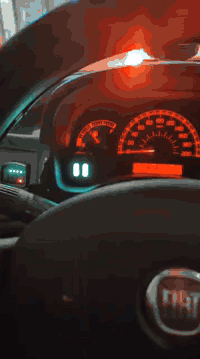
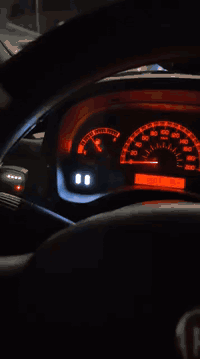
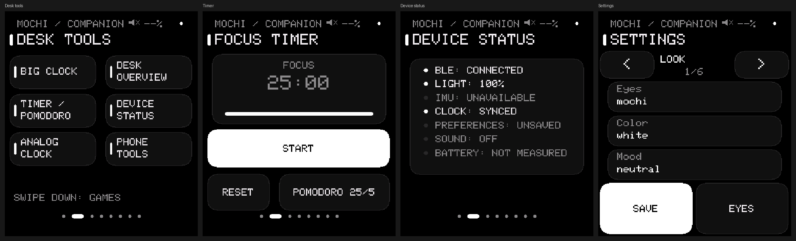
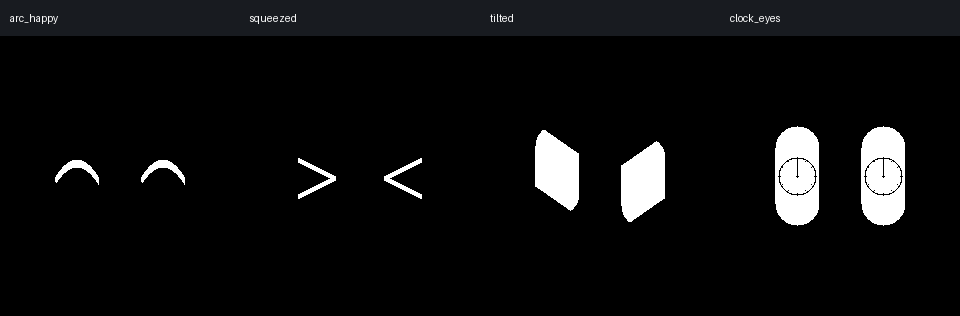
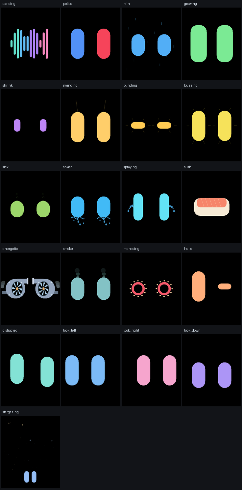

<div align="center">

# OTA-Bot-Mochi
### ESP32-S3 desk and dashboard companion with 254 animated expressions

[](LICENSE)


[](https://github.com/camiu01/OTA-Bot-Mochi/actions/workflows/checks.yml)




[Releases](https://github.com/camiu01/OTA-Bot-Mochi/releases) · [What it does](#what-it-does) · [Getting started](#getting-started) · [Usage](#usage) · [Configuration](#configuration) · [How it works](#how-it-works) · [Limitations](#limitations) · [Development](#development) · [License](#license)

</div>

OTA-Bot-Mochi is a small robot face for a desk or a car dashboard. It blinks, looks around, reacts to touch
and tilt, and shows time, weather, notifications, navigation, music and live engine data from a phone or a BLE
OBD-II dongle. The Eyes page is always home: every other page returns to it when left idle.

The firmware is an Arduino C++ sketch for two Waveshare boards: **ESP32-S3-Touch-LCD-1.69 OLD** (default) and
**ESP32-S3-Touch-AMOLED-1.8 V2**.

## What it does

| Area | Features |
| --- | --- |
| Eyes | Ten styles (`mochi`, `bloub`, `normal`, `trapez`, `anime`, `kitsune`, `drl`, `pixel`, `round`, `visor`), 254 moods, blinking and idle gaze, touch/petting/tilt/shake reactions, 26 [colored performances](docs/ANIMATIONS.md) |
| Clock | Digital, big and analog clocks synced by Chronos or NTP over saved Wi-Fi; keeps time while disconnected |
| Desk tools | Overview, timer (5 / 15 min, Pomodoro 25/5, tea, pasta, break reminder, custom 1-180 min, stopwatch), tally counter, two-player scoreboard, device status, [Android phone tools](docs/CHRONOS.md) |
| Games | Polyhedral D&D dice, Pong, Tic-tac-toe, Flappy Bird |
| Drive | Lean and G-meter from the gyro-fused IMU, 10 s graph, trip peaks, phone next turn, and BLE ELM327 OBD-II data ([details](docs/DESK.md#drive-dashboard)) |
| OBD-II | Speed, RPM with a configurable full scale and four gauge styles, plus four of sixteen values (temperatures, throttle, fuel, battery/ECU voltage, load, MAP, MAF, timing, fuel trims, O2, barometer, run time) and the check-engine lamp |
| Phone | Notifications (eight kept), incoming calls, navigation, music controls; Android via Chronos, iPhone via ANCS/AMS |
| Weather | Phone weather or Open-Meteo over saved Wi-Fi, with three forecasts |
| Sound | Optional generated cues and, on AMOLED, short SD WAV effects; off by default |
| Settings | Touch menu, USB console and a local browser page; English or Italian |
| Updates | Browser OTA over LAN or a temporary access point; microSD update on AMOLED |

Without a phone you still get the eyes, clocks after NTP sync, desk tools, games, Drive and OBD.



The GIFs at the top are phone recordings of a real board on a car dashboard. The other images are emulator
screenshots with synthetic data.





To export GIFs of any face, run `tools/export-gifs.bat` (Windows) or `./tools/export-gifs.sh`; see
[GIF export](docs/GIF_EXPORT.md).

<a id="start-here"></a>
## Getting started

### Hardware

Use exactly one of these boards. Other revisions (new 1.69, AMOLED V1 / SH8601) are not supported.

| Board | Display | Memory | Build setting |
| --- | --- | --- | --- |
| Waveshare ESP32-S3-Touch-LCD-1.69 **OLD** | ST7789 240x280 SPI, CST816/FT6X36 touch | 16 MB flash | PSRAM **disabled** |
| Waveshare ESP32-S3-Touch-AMOLED-1.8 **V2** | CO5300 368x448 QSPI, CST820 touch | 16 MB flash, 8 MB PSRAM | PSRAM **OPI** |

Both boards carry the QMI8658 IMU; the LCD has a buzzer, the AMOLED an ES8311 codec, AXP2101 PMU and microSD.
Power from a regulated USB source; never connect a vehicle's 12 V line directly.

> [!WARNING]
> Never enable OPI PSRAM on the LCD OLD board: it claims the buzzer and power-control GPIOs and causes continuous
> beeping and I2C crashes. Never flash one board's image onto the other.

Pin assignments are in [pin_config.h](OTA-bot-Mochi/pin_config.h) and [Boards](docs/BOARDS.md).

<a id="wiring-and-board-configuration"></a>
### Install a release

Download the files for your board from [Releases](https://github.com/camiu01/OTA-Bot-Mochi/releases) and follow
[Installing](docs/INSTALLING.md). The first OTA-capable install must go over USB (new partition layout); later
updates can use the [browser OTA page](docs/OTA.md) or, on AMOLED, SYSTEM → Firmware from SD.

### Build from source

Choose one path. Arduino CLI is the CI reference; PlatformIO mirrors the same profiles.

**PlatformIO:**

```sh
pio run -e esp32s3-amoled --target upload --upload-port COM3
pio run -e esp32s3-lcd --target upload --upload-port COM3
```

**Arduino CLI 1.2.0** with ESP32 core 3.3.12, ChronosESP32 1.9.1, GFX Library for Arduino 1.6.9,
ESP32Time 2.0.6 and NimBLE-Arduino 2.5.2:

```sh
arduino-cli core install esp32:esp32@3.3.12 --additional-urls https://espressif.github.io/arduino-esp32/package_esp32_index.json
arduino-cli lib install "ESP32Time@2.0.6" "NimBLE-Arduino@2.5.2"
arduino-cli lib install --no-deps "ChronosESP32@1.9.1" "GFX Library for Arduino@1.6.9"
```

```sh
# AMOLED 1.8 V2
arduino-cli compile --fqbn "esp32:esp32:esp32s3:CDCOnBoot=cdc,PSRAM=opi,FlashSize=16M" --build-property "upload.maximum_size=6553600" --build-property "compiler.cpp.extra_flags=-DMOCHI_BOARD_AMOLED_18" --build-path build/amoled OTA-bot-Mochi
arduino-cli upload --port COM3 --fqbn "esp32:esp32:esp32s3:CDCOnBoot=cdc,PSRAM=opi,FlashSize=16M" --build-path build/amoled OTA-bot-Mochi
```

```sh
# LCD 1.69 OLD
arduino-cli compile --fqbn "esp32:esp32:esp32s3:CDCOnBoot=cdc,PSRAM=disabled,FlashSize=16M" --build-property "upload.maximum_size=6553600" --build-property "compiler.cpp.extra_flags=-DMOCHI_BOARD_LCD_169" --build-path build/lcd OTA-bot-Mochi
arduino-cli upload --port COM3 --fqbn "esp32:esp32:esp32s3:CDCOnBoot=cdc,PSRAM=disabled,FlashSize=16M" --build-path build/lcd OTA-bot-Mochi
```

Keep the `upload.maximum_size` override: it matches the 6.25 MiB OTA slots in `partitions.csv`. Toolchain setup
is in [Testing](docs/TESTING.md).

### First boot

Keep the board still: the IMU restores its saved zero or takes a temporary one. After a 2.2 s intro the eyes
greet you. Defaults: white MOCHI eyes, neutral mood, 30 % brightness, sound off. The serial console runs at
115200 baud and prints `UI ready`, the touch address and the IMU state.

### Connect a phone

- **Android:** open **Chronos**, connect to **`OTA bot`** and sync the time.
- **iPhone:** Settings → SYSTEM → Phone mode → iPhone, SAVE, restart, then pair and allow notifications.
- **Wi-Fi:** Settings → SYSTEM → Web settings to save a 2.4 GHz network, time zone and weather city
  ([Network](docs/NETWORK.md)).

<a id="controls-and-everyday-use"></a>
## Usage

Main pages: `Eyes → Clock → Music → Route → Alerts → Weather → Drive → Settings`.

| Action | Result |
| --- | --- |
| Swipe left / right | Next / previous main page |
| Tap, double tap or stroke on Eyes | Glance, playful face, or petting heart |
| Hold on Eyes for 1.2 s | Open Settings |
| Swipe down on Clock | Desk tools; swipe down again for Games |
| Swipe up | Back one level |
| Swipe down on Drive | Drive tools: big lean, G-meter, graph, trip, OBD |
| Tap the Drive home | Reopen the last Drive tool |
| Hold on Drive, Timer, Tally or Score | Zero / reset |
| Swipe down on Route / Weather | Toggle route layout / refresh weather |
| Tap the top status strip | Mute sound for the session |

New notifications open Alerts and return after the configured alert time; a new route opens Route. Idle pages
go back to Eyes after the configured time, except Drive, an active route or timer, a call, and unsaved Settings.
Use the touch controls only while stopped.

See [UI](docs/UI.md) and [Desk tools](docs/DESK.md).

## Configuration

Changes apply at once; only **SAVE** keeps them after a reboot. The same options are in the touch menu, the
[browser settings page](docs/WEB_SETTINGS.md) and the USB console.

| Group | Options |
| --- | --- |
| Look | Eye style (ten), color, mood, animation preset, random moods, face flow, favorites and excluded faces |
| Display | Day 5–90 %, night 1–20 %, night schedule, idle dimming, 180° flip, alert time 5–120 s, back-to-Eyes time (0 = never, up to 240 s) |
| Motion | IMU moods, shake, IMU zero, session auto-rotate |
| Sound | Master, level 1–30, faces / timer / alerts / ambient / charging, night mute, SD effects (AMOLED) |
| Car | OBD scan, RPM gauge style, max RPM, four OBD values |
| System | Language, phone mode, route layout, call overlay, firmware update, diagnostics |

USB console example (115200 baud, newline):

```text
show
set style mochi
set brightness 30
set obd-scan on
save
```

Accepted values: [Settings](docs/SETTINGS.md) and [Sound](docs/SOUND.md). Board pins and geometry are
compile-time constants in [pin_config.h](OTA-bot-Mochi/pin_config.h).

<a id="firmware-architecture"></a>
## How it works

Paths are relative to `OTA-bot-Mochi/`.

| Module | Responsibility |
| --- | --- |
| `OTA-bot-Mochi.ino` | Hardware setup, BLE callbacks, touch dispatch and the 33 ms frame loop |
| `src/eyes/` | Expressions, gaze, geometry, dirty-region rasterization, scenes, IMU |
| `src/ui/` | Pages, desk/drive tools, BLE snapshots, theme and EN/IT text |
| `src/vehicle/` | BLE ELM327 client: worker task, framing and PID decoding |
| `src/settings/` | Validated profile (v12), NVS save, touch menu, USB parser |
| `src/network/`, `src/update/` | Wi-Fi, NTP, weather worker, browser settings and OTA |
| `src/ancs/`, `src/touch/`, `src/sound/`, `src/power/`, `src/play/`, `src/bus/` | iPhone, touch, audio, power, games, shared I2C |

Each frame is drawn into an `Arduino_Canvas` and flushed whole; the AMOLED canvas lives in PSRAM. BLE, OBD and
HTTPS callbacks only copy bounded data; the main task draws, plays sound and saves.

<a id="limitations-and-troubleshooting"></a>
## Limitations

- OBD needs a **BLE** ELM327 dongle and an OBD-II car; Classic-Bluetooth and Wi-Fi dongles do not work. The dongle
  accepts one connection, so close other OBD apps first. Values the ECU does not support (often fuel level)
  show `--` and stop being polled.
- No GPS, voice, call answering or battery-charger configuration. Battery percentage is an estimate.
- Power use, battery runtime and long-term stability are not measured; open items are in [TODO](TODO.md).
- The bitmap font approximates accents; emoji are not rendered.

| Symptom | Check |
| --- | --- |
| Blank screen, beeping, crashes | Board revision and PSRAM setting |
| Clock shows `--:--` | Sync with Chronos or save Wi-Fi for NTP |
| OBD stuck on "searching" | Ignition on, dongle not connected to a phone, OBD scan enabled |
| Changes lost after reboot | Tap SAVE and check it succeeded |
| No sound | Sound is off by default; check master switch and night mute |

## Development

Native tests need `g++` (C++17, `-Wall -Wextra -Werror`):

```powershell
.\scripts\test-host.ps1
git -c core.whitespace=cr-at-eol diff --check
```

On Linux/macOS: `bash scripts/test-host.sh`. They cover eye rasterization, gestures, settings migration, UI
pages on both panel sizes, OBD decoding and audio, but not real radio or hardware. The SDL2 emulator runs with
`.\tools\run-emulator.ps1 -Size 368x448`; see [Testing](docs/TESTING.md). New faces:
[Adding a face](docs/ADDING_A_FACE.md). Style and commits: [Contributing](CONTRIBUTING.md).

<a id="credits-and-license"></a>
## License

Copyright (c) 2026 [Camiu](https://github.com/camiu01), [GNU GPL v3](LICENSE) (`GPL-3.0-or-later`).

Credits: Arduino GFX, ChronosESP32, NimBLE-Arduino, bloub eyes, Dasai Mochi and Cozmo-style inspiration; no
affiliation implied. Third-party terms are listed in [Dependencies](docs/DEPENDENCIES.md).
